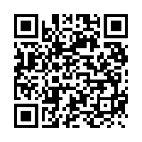

# Scorer for Tacta

The [Tacta card game](https://theop.games/products/tacta) is a fun, quick game. But what's not so
fun or quick is the scoring at the end.

This scorer app is here to solve that! Take a picture of the table and it counts each player's
visible dots, and circles every dot it counted so you can check its work.

It runs in your phone's browser. Nothing to install, no account, and your photo never leaves your
phone.

[Try it!](https://dice2cu.github.io/scorer-for-tacta/)

Or scan this QR code:

## How to use it

1. Open [the app](https://dice2cu.github.io/scorer-for-tacta/) on your phone and tap
   **Take or choose a photo**.
2. Photograph the whole board, as straight from above as you can, in even light. Glare on a few
   cards is fine; heavy glare can hide dots.
3. A few seconds later you get each player's dot count (and card count), with the photo marked up
   (see below).
4. If something is wrong, fix it on the photo: tap a dot to stop or start counting it, or tap a
   missed dot on a card to add it. Pinch to zoom. The scores update as you tap, and
   **Undo my changes** puts everything back.

### The marks on the photo

| Mark                                | Meaning                                                                    |
| ----------------------------------- | -------------------------------------------------------------------------- |
| Solid circle in the player's colour | Counted                                                                    |
| Dashed coloured ring                | A dot partly covered by another card, not counted                          |
| Dashed grey ring                    | Looks like a dot but isn't on a card the app found, not counted. Check it. |
| Crossed-out circle                  | A dot you turned off                                                       |

### Offline support

Open the app once while online and it keeps working offline after that. To get an app icon, use
**Add to Home Screen** (iPhone: the Share menu; Android: the browser menu).

### If the results look very wrong

Under **Advanced**, turn off **Use the GPU** and tap **Score this photo again**. A few phones'
graphics drivers give wrong results; without the GPU, scoring is slower but works everywhere.

## How it works

A small neural network, trained on computer-generated pictures of Tacta boards, finds every card's
centre badge and every visible dot. Ordinary geometry then works out where each card lies and which
of its printed dot positions are still visible, and only those are counted. A card's colour comes
mainly from the symbol on its badge, so dim or coloured light doesn't confuse the players. All of
this runs in the browser, on the phone.

## Contributing

See [CONTRIBUTING.md](CONTRIBUTING.md) for how to build, test and change the app, and
[TRAINING.md](TRAINING.md) for how to train the model on your own photos.

## License

Your choice of [MIT](LICENSE) or the [Unlicense](UNLICENSE).
